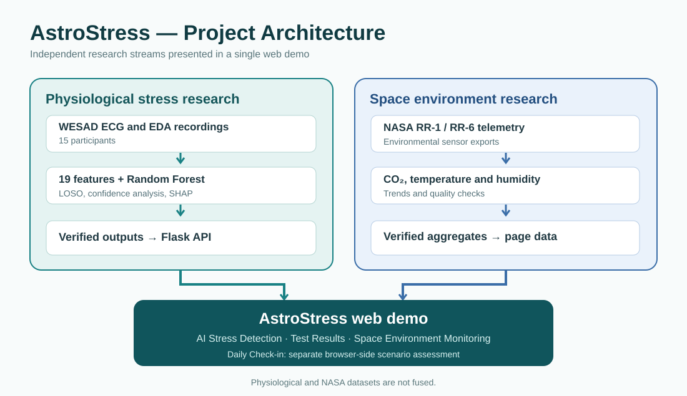

# AstroStress

**[Live Demo](https://astrostress-nasa-2026-33ym1m8wr-pakeeza-khalids-projects.vercel.app/)**

AstroStress explores explainable AI for physiological stress detection, alongside independent analysis of NASA space-environment telemetry.

## How AstroStress Works

The project studies two separate data sources. **WESAD** provides ECG and skin-conductance recordings for training and evaluating a Random Forest stress classifier. We use Leave-One-Subject-Out testing, SHAP explanations and confidence analysis to understand model performance. **NASA RR-1/RR-6** telemetry provides CO₂, temperature and humidity readings for environmental trend and data-quality analysis. The data sources are displayed together, but have **not been combined into one prediction model**.

The web demo also includes a **Daily Check-in** for self-reported mission-readiness scenarios. This runs separately from the trained sensor-based classifier. Performance charts and dataset details are available directly in the demo.

## System Architecture



## Run Locally

Use Python 3.12 and a trusted local copy of the verified research artifacts.

```bash
git clone https://github.com/Pakeeza1508/AstroStress_.git
cd AstroStress_
python -m pip install -r requirements.txt
python app_server.py
```

Open **http://127.0.0.1:8000/**.

The server expects the generated `astrostress_output/` research/model artifacts. To reproduce them, download WESAD from the [dataset source](https://ubi29.informatik.uni-siegen.de/usi/data_wesad.html) and follow the feature-extraction and evaluation scripts (`astrostress_complete.py` and `astrostress_v2.py`). Research training may require additional Python packages beyond the deployment requirements.

## Team

[Project contributors](https://github.com/Pakeeza1508/AstroStress_/graphs/contributors)

## References

[WESAD dataset](https://ubi29.informatik.uni-siegen.de/usi/data_wesad.html) · [NASA Environmental Data Application](https://visualization.osdr.nasa.gov/eda/) · [NASA Space Apps Challenge 2026](https://www.spaceappschallenge.org/2026/challenges/health-monitoring-software/)

**License:** [Apache 2.0](LICENSE) for source code; external datasets follow their original terms.
